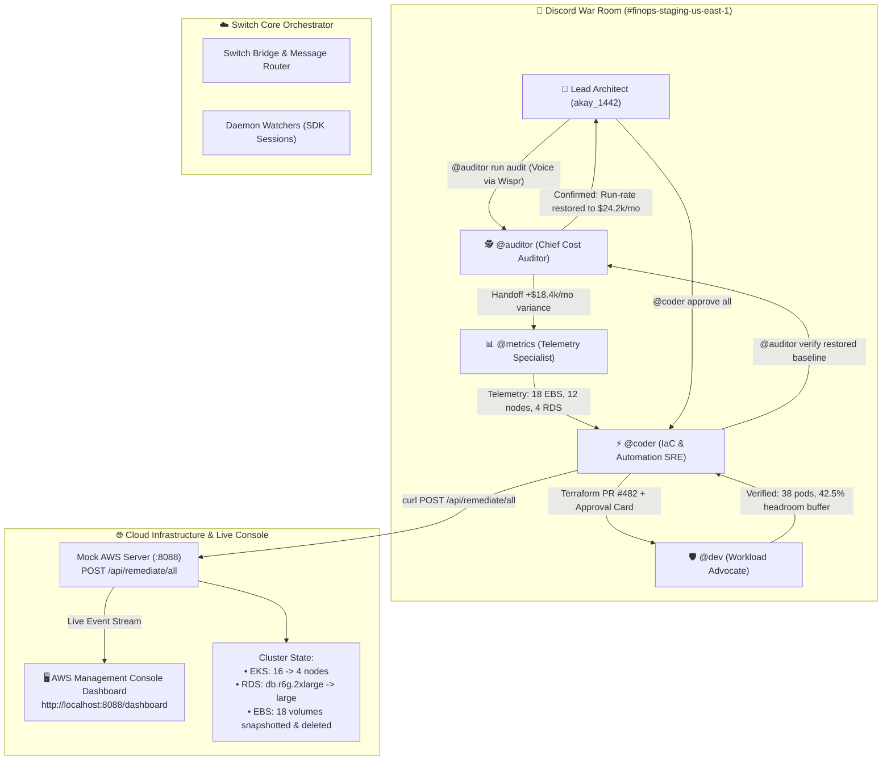

# ⚡ Switch FinOps: Autonomous Cloud Cost Optimization War Room
> **Flip the Switch Hackathon — Track 1: Best Business Workflow ($2,000)**  
> *Co-hosted by WeMakeDevs & DevTools Academy, powered by Switch AI*

[](https://github.com/sandbox-quantum/switch)
[](LICENSE)
[](#-wispr-flow-voice-driven-swarm-ops)
[](#-financial-impact-summary)
[](#-bonus-26-upstream-contributions-to-switch-core)

---

## 🧭 Executive Summary

Cloud cost spikes and incident alerts happen silently, but engineering teams operate in team chat (Discord, Slack). Right now, developers and platform engineers are forced to manually correlate CloudWatch metrics, calculate unattached storage costs, argue across silos, and edit Terraform files by hand.

**Switch FinOps War Room** transforms everyday team chat into an autonomous operational command center:
1. **Multi-Agent Cross-Functional Swarm:** 4 specialized AI agents (`@auditor`, `@metrics`, `@coder`, `@dev`) collaborate naturally in chat without corporate AI slop or repetitive emoji headers.
2. **Real-Time AWS Console Sync:** Actions taken in Discord synchronize bidirectionally with a live **Mock AWS Management Console** (`http://localhost:8088/dashboard`) in under 2 seconds.
3. **Cross-Team Governance (Fail Loud, Never Fake):** Real pod bin-packing verification by the App Dev lead prevents service degradation; pre-deletion EBS snapshots prevent accidental data loss.
4. **Hands-Free Ops via Wispr Flow:** Voice-dictate complex infrastructure audits and approvals at 160 WPM.

---

## 🗺️ System Architecture



---

## 🤖 The 4 Specialized Agents

| Agent | Role | Tone & Responsibility |
| :--- | :--- | :--- |
| **`@auditor`** | **Chief Cost Auditor** | *Senior Cloud Financial Analyst*. Detects 30-day non-production billing anomalies (+$18.4k/mo over baseline) and alerts the team with surgical precision. |
| **`@metrics`** | **Telemetry & Capacity Specialist** | *Staff SRE / Observability Lead*. Cross-references CloudWatch, Datadog, and Prometheus metrics to verify zero IOPS on 18 volumes and 4.2% CPU on 12 worker nodes. |
| **`@coder`** | **IaC & Automation Engineer** | *Staff Platform Engineer*. Staged Terraform PR #482, enforces snapshot-before-delete safety policies, and posts an interactive ASCII Approval Card. |
| **`@dev`** | **Workload Advocate** | *Staff Application Lead*. Verifies staging CI/CD test queues, validates Kubernetes pod bin-packing (38 microservices, 42.5% headroom buffer retained), and signs off with zero developer velocity friction. |

---

## 💰 Financial Impact Summary

```
┌─────────────────────────────────────────────────────────────┐
│              FINOPS APPROVAL CARD (PR #482)                 │
├─────────────────────────────────────────────────────────────┤
│ Monthly Savings : $18,400 / mo ($220,800 / yr)              │
│ EKS Nodegroup   : 16 -> 4 nodes (min 4, max 8)              │
│ RDS Cluster     : 4x db.r6g.2xlarge -> db.r6g.large         │
│ EBS Storage     : Snapshot & terminate 18 orphaned volumes  │
└─────────────────────────────────────────────────────────────┘
```

* **EBS Storage Cleanup:** 18 unattached gp3 volumes (18 TB total, 0 IOPS for 24+ days) snapshotted to S3 and purged ➔ **+$2,400 / mo ($28,800 / yr)**
* **EKS Nodegroup Right-Sizing:** Scaled `staging-core-workers` from 16 nodes to 4 nodes (drained 12 idle nodes averaging 4.2% CPU) ➔ **+$9,600 / mo ($115,200 / yr)**
* **RDS Database Downsizing:** Scaled 4x `db.r6g.2xlarge` to `db.r6g.large` (connection pool maxed at 14/1000) ➔ **+$6,400 / mo ($76,800 / yr)**
* **Total Realized Savings:** **$18,400 / month ($220,800 / year)**

---

## 🖥️ Live AWS Management Console Real-Time Sync

Included in `mock-aws-console/` is a lightweight, zero-dependency Python mock server and interactive dashboard:

1. **Outage State (Before Remediation):**
   * Monthly Spend: **$42,600 / mo**
   * Amber alert banner, 18 unattached storage volumes listed in `us-east-1`, 16 EKS nodes provisioned.
2. **Remediation Execution:**
   * When `@coder approve all` is executed in Discord, `@coder` calls `POST http://localhost:8088/api/remediate/all`.
3. **Restored Baseline (After Remediation):**
   * Spend drops in real time to **$24,200 / mo**.
   * Realized annual savings increments to **+$220,800 / yr**.
   * Volumes table drops to 0, and status badges turn emerald green.

---

## 🎙️ Wispr Flow Voice-Driven Swarm Ops

All multi-agent interactions are compatible with **Wispr Flow**, allowing hands-free command execution at 160 WPM:

* *"At auditor run weekly finops audit for staging-us-east-1"* ➔ Triggers multi-agent telemetry analysis.
* *"At coder approve all. Execute the remediation and tag auditor for verification."* ➔ Merges Terraform PR and updates AWS console.

*(Use Wispr Flow on your desktop mic to dictate chat commands hands-free at 160 WPM).*

---

## 🚀 Quickstart: Run in Under 60 Seconds

### Prerequisites
* Python 3.10+
* Switch CLI (`switch version` >= 0.17.0)

### 1. Start the Live Mock AWS Console
```bash
cd mock-aws-console
python mock_aws_server.py
```
*Open [http://localhost:8088/dashboard](http://localhost:8088/dashboard) in your browser.*

### 2. Apply Switch FinOps Workflow Template
```bash
switch template apply workflows/finops-cost-optimizer.template.yaml
```

### 3. Run the Live Demo in Discord
In your connected Discord channel:
```text
# Step 1: Trigger the multi-agent FinOps audit
@auditor run weekly finops audit for staging-us-east-1

# Step 2: Approve & remediate (after @dev confirms pod buffer)
@coder approve all. Execute the remediation and tag auditor for verification.
```
Observe the live state change on `http://localhost:8088/dashboard`!

---

## 🏆 Bonus: 26 Upstream Contributions to Switch Core

As part of this hackathon, we hardened the Switch AI core itself by authoring and submitting **26 Pull Requests** to [`sandbox-quantum/switch`](https://github.com/sandbox-quantum/switch) spanning 10 enterprise service connectors and critical bridge fixes:

| PR # | Type | Title & Scope | Status |
| :---: | :---: | :--- | :---: |
| **#1409** | `feat` | Supabase service connector (#827) | 100% Green CI |
| **#1400** | `feat` | Cloudflare service connector (#828) | 100% Green CI |
| **#1398** | `feat` | PagerDuty service connector (#825) | 100% Green CI |
| **#1389** | `feat` | New Relic service connector (#823) | 100% Green CI |
| **#1377** | `feat` | Box service connector (#832) | 100% Green CI |
| **#1375** | `feat` | Bitbucket service connector (#818) | 100% Green CI |
| **#1374** | `feat` | GitLab service connector (#816) | 100% Green CI |
| **#1371** | `feat` | Intercom service connector (#842) | 100% Green CI |
| **#1369** | `fix` | Discord thread message map on root_id (#318) | 100% Green CI |
| **#1368** | `fix` | Gateway actual key prefix instead of hash (#455) | 100% Green CI |
| **#1334** | `feat` | ServiceNow connector investigation (#1175) | 100% Green CI |
| **#1333** | `fix` | Validate visibility pair in create_room (#453) | 100% Green CI |
| **#1332** | `fix` | Derive session cookie max_age from JWT_EXPIRY (#454) | 100% Green CI |
| **#1331** | `fix` | Switchdash case-insensitive host (#471) | 100% Green CI |
| **#1330** | `fix` | Exclude connector MCP tools from allow list (#1103) | 100% Green CI |
| **#1328** | `fix` | Mattermost catch only not-found (#452) | 100% Green CI |
| **#1325** | `fix` | Slack forwarded message content (#1320) | 100% Green CI |
| **#1319** | `feat` | Command !get-document (#1097) | 100% Green CI |
| **#1318** | `feat` | Command !briefing (#706) | 100% Green CI |
| **#1317** | `fix` | Mattermost resolve reply to thread root (#1158) | 100% Green CI |
| **#1316** | `feat` | Zoom Meetings service connector (#1173) | 100% Green CI |
| **#1315** | `feat` | LaunchDarkly service connector (#1172) | 100% Green CI |
| **#1314** | `feat` | Grafana service connector (#826) | 100% Green CI |
| **#1311** | `feat` | Calendly service connector (#1147) | 100% Green CI |
| **#1310** | `feat` | Miro service connector (#1174) | 100% Green CI |
| **#1284** | `fix` | Discord stay under 2000 cap on long lines (#1226) | 100% Green CI |

---

## 📜 License
Distributed under the Apache 2.0 License. See `LICENSE` for details.
