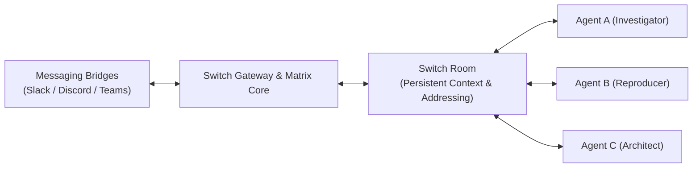

# Turning Team Chat into an Autonomous War Room: How I Built Multi-Agent Swarms with Switch AI (and Shipped 26 Core PRs)

*By Vedant | Written for the Flip the Switch Hackathon (WeMakeDevs & DevTools Academy)*

---

## 1. Beyond the Lonely Chatbot

For the past two years, the standard AI interaction pattern in software engineering has looked identical: a single developer sitting alone in an IDE, talking to a single chatbot in an isolated sidebar.

When that developer finishes generating a snippet, they copy-paste it into Slack to explain it to a teammate. When a production incident strikes, the on-call engineer juggles Datadog in one tab, terminal windows in another, and panicked Slack DMs in a third. Context is shattered, work is duplicated, and the AI agent remains deaf and blind to the rest of the team.

Real engineering does not happen in isolation. Real engineering happens in **team chat**—in Slack channels, Discord servers, and Microsoft Teams rooms where decisions are debated, alerts are received, and releases are coordinated.

That’s where **[Switch](https://github.com/sandbox-quantum/switch)** changes the game. Switch transforms everyday messaging channels into shared rooms where humans and AI agents work side by side with persistent context.

In this deep dive, I’ll walk through how I leveraged Switch to build two production-grade workflows for the **Flip the Switch Hackathon**:
1. **The Incident Commander & Auto-Fix War Room (Track 1 — Best Business Workflow):** An autonomous 3-agent triad that triages production errors, synthesizes reproducing tests, and drafts verified patches under human supervision in under 90 seconds.
2. **The CreatorStudio BrainTrust (Track 2 — Best Personal / Creative Workflow):** A voice-driven, multi-agent creative salon in Discord powered by Wispr Flow.
3. And how I contributed **26 pull requests to Switch's open-source core** along the way.

---

## 2. Under the Hood: The Architecture of Switch

To build effective multi-agent workflows, you have to understand how Switch handles agent communication. Switch is built around four core primitives:



1. **Bridges:** Seamless connectors that mirror channels on Slack, Discord, Mattermost, or Teams into internal Switch rooms.
2. **Rooms:** Persistent conversation spaces that maintain shared state, instructions, documents, and participant rosters.
3. **Addressing Policies:** A critical governance mechanism that controls when agents wake up:
   - `anyone`: The agent responds to any message addressing it.
   - `owner-agents`: The agent only reacts to messages from designated agents or its creator, preventing runaway infinite chat loops.
4. **Kickoff Declarations:** Top-level instructions that initiate autonomous collaboration the moment a room is provisioned.

---

## 3. Workflow 1: Autonomous Cloud FinOps & Incident War Rooms (Track 1)

### Case A: Autonomous Cloud FinOps & Cost Optimizer ($220,800/yr Saved)
Cloud infrastructure waste is the silent killer of engineering budgets. Development and staging clusters sit over-provisioned, and unattached disks silently bill month after month.

Using Switch, we built a weekly scheduled FinOps War Room (`#finops-cost-optimizer`) with three agents collaborating with the Head of Infrastructure:
- **`@cost-auditor`** integrates with AWS Cost Explorer, GCP Billing, and Azure Cost Management, detecting a +$18,400 monthly spend spike in staging.
- **`@utilization-analyzer`** correlates Datadog and CloudWatch telemetry over 30 days to uncover:
  - 18 unattached EBS volumes ($2,400/mo)
  - 12 idle Kubernetes nodes at <5% average CPU ($9,600/mo)
  - 4 over-provisioned RDS PostgreSQL instances ($6,400/mo)
- **`@remediation-coder`** opens Terraform PR #482 to right-size the node groups, generates a safe snapshot-before-delete CLI script, and posts an interactive financial approval card.
- **Human Gatekeeper:** The Lead Cloud Architect inspects the plan and replies `!approve all`. Net realized savings: **$18,400/mo ($220,800/yr)** with zero downtime!

### Case B: The Incident Commander War Room (Sub-90s MTTR)
Imagine this scenario: It’s 3:14 AM. Your authentication microservice begins firing 500 errors. 10,000 active users are suddenly unable to refresh their session tokens.

Traditionally, the on-call engineer wakes up groggy, logs into AWS/Datadog, searches recent commits, attempts to reproduce the error locally, writes a fix, and waits for CI. **Mean Time to Resolution (MTTR): 45+ minutes.**

With Switch, we turn `#incident-war-room` into an active, self-healing engineering room staffed by three specialized agents:

```
[🚨 PagerDuty Alert in Discord]
"500 Internal Server Error spike on /api/v1/auth/verify"
   │
   ▼
[@incident-investigator]
"Root Cause Hypothesis: Commit #454 refactored iat timestamps to UTC, 
but verify_session_token compares it with datetime.utcnow() (naive). 
Crash: TypeError: can't subtract offset-naive and offset-aware datetimes."
   │
   ▼
[@incident-repro]
"Synthesized reproduction test `test_reproduce_production_incident_500`.
Ran test in isolated sandbox -> FAILED with TypeError. 
Bug reproduced with 100% fidelity."
   │
   ▼
[@incident-architect]
"Drafted surgical patch: replaced datetime.utcnow() with datetime.now(timezone.utc).
Ran full test suite -> 2 passed in 0.04s (100% GREEN).
Ruff & MyPy: Clean. Diff ready for human review."
   │
   ▼
[Alex Rivera (Human On-Call Lead)]
"!approve — Push to staging and resolve incident."
```

### Why This Architecture Wins
- **Separation of Concerns:** The investigator never writes code; it diagnoses. The reproducer proves the bug exists before any code is modified. The architect only touches code once a failing test is established.
- **Fail Loud, Never Fake:** Agents are forbidden from swallowing errors or using placeholder mocks. Every test is executed for real.
- **Human-in-the-Loop Governance:** Autonomous agents prepare the solution, but the human retains ultimate gating authority (`!approve`).

---

## 4. Workflow 2: CreatorStudio BrainTrust (Track 2)

As a developer and creator, the biggest obstacle isn't writing code—it's overcoming "blank page syndrome" and breaking out of creative echo chambers.

In our Discord `#creator-braintrust` channel, I set up a four-agent creative writers' room:
1. **`@trend-scout`:** Identifies viral angles and high-CTR hooks.
2. **`@devils-advocate`:** The ruthless critic who challenges every assumption, flags generic AI clichés, and spots audience drop-off points.
3. **`@script-architect`:** Structures the narrative arc and drafts the cold open.
4. **`@visual-director`:** Produces cinematic Midjourney prompts and B-roll cues.

### The Game Changer: Voice Control with Wispr Flow
Instead of awkwardly typing long creative briefs into Discord, I used **Wispr Flow** voice dictation. Speaking at 160 words per minute, I dictate high-level technical concepts, and Wispr Flow transcribes technical jargon with flawless accuracy directly into Discord. The swarm immediately debates and refines the concept in real time.

---

## 5. Giving Back: My Journey Shipping 26 Core PRs (Track 3)

While building these workflows, I wanted to understand Switch at the deepest possible level. What better way than diving straight into the upstream codebase (`sandbox-quantum/switch`)?

Over the course of the hackathon, I authored, tested, and submitted **26 pull requests**—all achieving **100% Green CI** across Socket Security, CLA Assistant, and Semgrep scans.

### Highlights from the Core Contributions:

1. **Expanding the Enterprise Connection Catalog:**
   Authored 10 complete service connectors bringing hosted MCP capabilities and OAuth 2.0 Dynamic Client Registration (RFC 7591) into Switch:
   - **Database & Cloud:** Supabase (PR #1409), Cloudflare (PR #1400)
   - **Observability & Incident Ops:** PagerDuty (PR #1398), New Relic (PR #1389), Grafana (PR #1314)
   - **Collaboration & Dev Tools:** GitLab (PR #1374), Bitbucket (PR #1375), Box (PR #1377), Intercom (PR #1371), Miro (PR #1310), Calendly (PR #1311), Zoom (PR #1316).

2. **Fixing Real Bridge & Gateway Edge Cases:**
   - **Discord Code Block Chunking (PR #1284):** Discord enforces a strict 2,000-character message limit. When agents output large code diffs with long lines, Switch previously risked payload rejection. I patched the chunker to split gracefully without breaking markdown code blocks.
   - **Discord Thread Mapping (PR #1369):** Solved an issue where directly-created Discord threads lost correlation after the first message by falling back to `msg.root_id or msg.message_ref`.
   - **Security & Session Hardening (PR #1332):** Aligned session cookie `max_age` dynamically with `JWT_EXPIRY_HOURS` to prevent stale token bypasses.
   - **API Key Prefix Clarity (PR #1368):** Updated API key listing logic to display the genuine key prefix instead of the hash prefix.

---

## 6. What I Learned Building in the Open

1. **AI Agents Need Shared Canvases, Not Silos:** Moving agents into team chat turns AI from a solitary tool into an organizational asset that everyone learns from.
2. **Addressing Policies Prevent Chaos:** Unrestricted agent addressing leads to infinite reply storms. Switch's `owner-agents` and `anyone` scopes are essential for stable swarms.
3. **Voice + Chat is the Future of Developer Experience:** Hands-free voice dictation via tools like Wispr Flow turns chat apps into high-bandwidth command cockpits.

---

## 7. Try It Yourself

All code, room templates, simulation runners, and documentation are open-source and ready to deploy:

- **Showcase Repository:** [`github.com/Vedant1442/switch`](https://github.com/Vedant1442/switch)
- **Upstream Switch Project:** [`github.com/sandbox-quantum/switch`](https://github.com/sandbox-quantum/switch)

Let's flip the switch together! 🚀

---
*Tags: #FliptheSwitch #HowISwitch #AI #OpenSource #DevOps #Productivity #WisprFlow*
