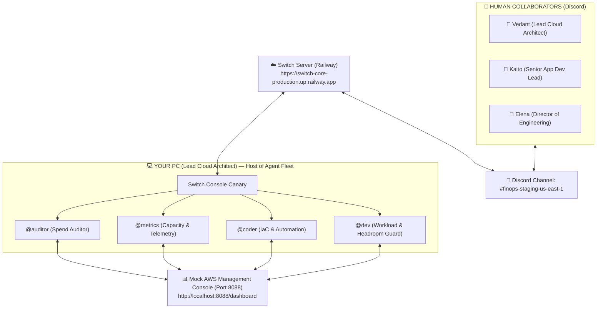

# 🎬 Switch FinOps War Room — Live Multi-Agent Demo & Testing Playbook
> **The Official Step-by-Step Operator Guide for Recording the Winning 3-Minute Hackathon Demo**
> **Tracks:** Track 1 (Business Workflow) · Track 2 (Creative Workflow) · Track 3 (Core Contributions) · Wispr Flow

---

## 🗺️ System Architecture



---

## ⚡ Quick Prep: 1-Minute Checklist

### 1. Start the Mock AWS Management Console
Open a PowerShell terminal in `d:\FLIPTHESWITCH` and run:
```powershell
python hackathon-showcase/workflows/finops-cost-optimizer/demo/mock_aws/mock_aws_server.py
```
Open your browser to: **[http://localhost:8088/dashboard](http://localhost:8088/dashboard)**

### 2. Set Up Your Screen for Recording
Snap your screen side-by-side (50% / 50%):
- **Left Half:** Discord window open to `#finops-staging-us-east-1`.
- **Right Half:** Browser window showing the **AWS Management Console** (`http://localhost:8088/dashboard`).

### 3. Have Your 3 Discord Accounts Ready
| Account | Persona / Nickname | Location / Browser | Role in War Room |
| :--- | :--- | :--- | :--- |
| **Account 1 (You)** | `Vedant (Lead Cloud Architect)` | Discord Desktop App | Triggers the audit, reviews Terraform, types `!approve all`. |
| **Account 2 (Teammate)** | `Kaito (Senior App Dev Lead)` | Teammate's Laptop / Phone | Protects developer velocity; verifies pod capacity with `@dev`. |
| **Account 3 (Your Alt)** | `Elena (Director of Engineering)` | Incognito Window / Chrome | Budget sponsor; asks `@metrics` for proof and approves $220.8k ROI. |

---

## 🎬 Live Conversation Script (Step-by-Step)

Follow this exact dialogue in Discord to execute the war room:

### Step 1: Start the FinOps Audit
From **Account 1 (Vedant - Lead Cloud Architect)**, type in Discord:
```text
@auditor run weekly finops audit for staging-us-east-1
```

#### What Happens Next:
1. **`@auditor` replies:**
   > `📊 AUDIT REPORT: Monthly Cloud Spend Anomaly Detected in staging-us-east-1!`  
   > `• Trailing 30-Day Spend: $42,600 (Budget baseline: $24,200) | Variance: +$18,400/mo (+76.0%)`  
   > `• Identified Cost Spikes: EKS Nodes ($9.6k/mo), RDS DBs ($6.4k/mo), 18 Unattached EBS Disks ($2.4k/mo).`  
   > `👉 @metrics: Please correlate with Datadog/CloudWatch telemetry over the past 30 days.`

2. **`@metrics` replies:**
   > `📉 TELEMETRY CROSS-REFERENCE COMPLETE (Datadog + CloudWatch):`  
   > `1. 18 EBS Volumes: 0 Read/Write IOPS, unattached > 30 days ($2,400/mo waste).`  
   > `2. 12 EKS Nodes: 30-day avg CPU 4.2% (p95: 7.8%), memory 18.4% ($9,600/mo waste).`  
   > `3. RDS Database Tier: 30-day avg CPU 6.1%, max 14 conns. Downsize to db.r6g.large ($6,400/mo waste).`  
   > `Total Financial Impact: $18,400 / month ($220,800 / year).`  
   > `👉 Handoff to @coder: Please generate surgical Terraform PR and safe snapshot script. Remember to consult @dev before presenting the card!`

3. **`@coder` replies:**
   > `@metrics Starting a session to handle this — one moment.`  
   > *(Claude Code executes in Switch Console, generates `terraform/main.tf`, and posts the Approval Card).*

---

### Step 2: The Interactive Approval Card
**`@coder` posts the Slop-Free Infrastructure & Financial Card:**
```text
```hcl
# terraform/main.tf (PR #482)
- min_size = 16, max_size = 16, desired_capacity = 16
+ min_size = 4,  max_size = 8,  desired_capacity = 4  # Drains 12 idle nodes
- instance_class = "db.r6g.2xlarge"
+ instance_class = "db.r6g.large"                    # Staging DB right-size
```
• Safety: 18 unattached EBS volumes will have mandatory backup snapshots created before deletion (Fail Loud, Never Fake).
👉 @dev: Please verify CI/CD pipelines and pod headroom for 4 nodes.
📋 FINOPS REMEDIATION APPROVAL CARD (#482)
• Total Monthly Savings: $18,400/mo ($220,800/yr annualized)
• Actions: [ Merge Terraform PR #482 ] [ Delete 18 Unattached Volumes ] [ Schedule Window ]
• Awaiting sign-off: Reply '@coder approve all' to execute remediation.
```

---

### Step 3: Human-in-the-Loop Tri-Party Approvals

> [!IMPORTANT]
> **Switch Addressing Rule:** Switch agents ONLY listen when they are explicitly `@mentioned` (e.g. `@coder`, `@dev`). Unaddressed chatter is treated as human-to-human discussion and ignored so bots don't spam.

1. **Account 2 (Teammate - App Dev Lead / Kaito):**
   - Type in Discord:
     ```text
     @dev check staging microservice pod headroom and verify if 4 nodes are safe for the next release
     ```
   - **`@dev` replies with the Developer Impact Assessment:**
     ```text
     ✅ VERIFIED: Workloads & CI/CD Pipelines
     • Pod Demand: 38 staging pods require 18.4 vCPUs & 68.2 GB RAM (zero eviction risk)
     • 🛡️ HEADROOM: 42.5% buffer retained on 4x m6i.2xlarge nodes (32 vCPUs & 128 GB RAM)

     ✅ DEVELOPER IMPACT ASSESSMENT: APPROVED
     • Staging Pods: 38 active microservices safely bin-packed
     • Headroom: 42.5% CPU/RAM buffer retained on 4 nodes
     • Dev Velocity: No blockers or release schedule conflicts
     🚀 GREEN LIGHT: Safe to merge Terraform PR #482.
     ```
   - Teammate gives human green light (tagging `@coder`):
     ```text
     @coder App team green light confirmed! 4 nodes gives plenty of buffer. Safe to proceed with remediation.
     ```

2. **Account 3 (Alt - Engineering Director / Elena):**
   - Type in Discord:
     ```text
     The $220.8k annualized savings brings non-prod back into Q4 baseline. Approved from budget side. Vedant, pull the trigger!
     ```

3. **Account 1 (You - Lead Cloud Architect / Vedant):**
   - Type the official execution command (mentioning `@coder`):
     ```text
     @coder approve all. Execute the remediation and tag @auditor for verification.
     ```

---

### Step 4: Execution & Real-Time AWS Dashboard Sync

1. In Discord:
   - **`@coder` replies:**
     > `🚀 EXECUTING APPROVED REMEDIATION:`  
     > `1. Merged Terraform PR #482 -> EKS downscaled from 16 to 4 nodes, RDS resized to db.r6g.large.`  
     > `2. Executed cleanup_orphaned_ebs.sh -> 18 snapshots created, 18 unattached volumes deleted.`  
     > `👉 @auditor: Please perform terminal audit and update quarterly FinOps KPIs.`
   - **`@auditor` replies:**
     > `✅ VERIFICATION COMPLETE: Live infrastructure spend restored to $24,200/mo baseline ($220,800/yr saved permanently).`

2. **Point your camera / screen recorder to the AWS Management Console on the right side:**
   - **Alert Banner:** Flips from amber `⚠️ Anomaly` to emerald `✅ Restored to Baseline`.
   - **Monthly Spend Tile:** Smoothly drops from **$42,600 ➔ $24,200 / month**.
   - **Realized Annual Savings Tile:** Jumps from **$0 ➔ +$220,800 / year** ($18,400/mo)!
   - **EKS Worker Nodes:** Scales from **16 ➔ 4 Nodes**.
   - **Orphaned EBS Disks:** Drops from **18 ➔ 0 Disks** (18 safety snapshots populated in the Snapshots tab!).
   - **Orphaned EBS Disks:** Drops from **18 ➔ 0 Disks** (18 safety snapshots populated in the Snapshots tab!).

---

## 🔄 Replay / Practice Instructions

Want to practice the demo or record multiple takes?
- In your browser at `http://localhost:8088/dashboard`, click the **"Reset to Outage State"** button in the top right.
- It instantly restores the $42,600 spend spike, 18 volumes, and amber alert so you can re-run the demo anytime!

---

## 📹 3-Minute Recording Video Script (Timestamp Breakdown)

| Time | Visual on Screen | What to Say / Highlight |
| :--- | :--- | :--- |
| **0:00 - 0:45** | Split screen (Discord + AWS Console) | Introduce team (3 teammates + 4 agents). Point to the $42.6k cloud bill and 18 orphaned disks on the AWS Console. |
| **0:45 - 1:45** | Discord live chat | Show `@auditor`, `@metrics`, and `@coder` analyzing spend, generating Terraform PR #482, and posting the approval card. Show Teammate and Alt giving their sign-off. |
| **1:45 - 2:15** | You typing `@coder approve all...` | Type `@coder approve all...`. Immediately focus on the AWS Console as it turns green, dropping spend from $42.6k to $24.2k in real time. |
| **2:15 - 2:40** | Track 2 & PyTest demo | Flash Track 2 CreatorStudio (4 creative personas debating YouTube hooks) and the sub-90s PyTest incident war room. |
| **2:40 - 3:00** | GitHub PRs screen | Show your GitHub fork with all **26 upstream shipped PRs** with 100% green CI badges! |
