# 💰 Autonomous Cloud FinOps & Cost Optimization Room
> **Flip the Switch Hackathon — Flagship Track 1: Best Business Workflow ($2,000 Cash Prize)**
> *Co-hosted by WeMakeDevs & DevTools Academy, powered by Switch AI*

[](https://github.com/sandbox-quantum/switch)
[](LICENSE)
[](#)
[](../../wispr/WISPR_FLOW_INTEGRATION.md)
[](#)

---

## 🎯 Target Domain: FinOps, DevOps & Cloud Governance

Cloud infrastructure waste is the single largest silent cost center for engineering organizations:
- **Orphaned Storage Disks:** Development and staging instances are terminated, but their attached EBS or Persistent Disks remain unattached, silently accruing charges month after month.
- **Over-Provisioned Kubernetes Clusters:** Staging clusters sized for peak load tests run continuously at <5% average CPU/Memory.
- **Over-Sized Databases:** Database instances provisioned with massive memory footprints sit idle during non-business hours.

Manual FinOps reviews require engineers to pull billing CSVs, manually correlate metrics across Datadog/CloudWatch, write Terraform PRs, and chase approvals across Slack. The result? **Cloud waste compounds for quarters before anyone acts.**

---

## 💡 The Solution: Autonomous Multi-Agent FinOps Swarm in Team Chat

**Autonomous Cloud FinOps & Cost Optimization Room** transforms any team chat channel (**Slack, Discord, Microsoft Teams, or Mattermost**) into a collaborative financial command center using **Switch**.

Three specialized AI agents continuously audit spend, cross-reference observability metrics, generate version-controlled Terraform pull requests, and post interactive financial approval cards for human cloud architects:

```mermaid
flowchart TD
    Cron["⏰ Weekly FinOps Schedule"] --> Room["Switch FinOps Room (#finops-cost-optimizer)"]
    Room --> Auditor["@auditor<br><b>Billing Specialist</b><br>• AWS / GCP / Azure Billing APIs<br>• Flags $18,400/mo spend spike"]
    
    Auditor -->|"Handoff with account & cluster tags"| Analyzer["@metrics<br><b>Telemetry Specialist</b><br>• Datadog / Prometheus / CloudWatch<br>• 18 unattached EBS disks ($2.4k/mo)<br>• 12 idle K8s nodes at <5% CPU ($9.6k/mo)<br>• 4 over-sized RDS DBs ($6.4k/mo)"]
    
    Analyzer -->|"Handoff with right-sizing specs"| Coder["@coder<br><b>IaC & Automation Engineer</b><br>• GitHub Terraform PR #482<br>• Safe CLI cleanup script<br>• Drafts Financial Approval Card"]
    
    Coder -->|"Handoff for developer workload safety"| DevAgent["@dev<br><b>Developer's Agent</b><br>• CI/CD Pipelines & Staging Schedules<br>• Pod Bin-Packing Verification<br>• Confirms 42.5% headroom & zero OOMs"]
    
    DevAgent -->|"Issues Developer Green Light"| Humans["👨‍💼 Human Engineering Leads<br>• Marcus Vance (Senior App Dev Lead)<br>• Elena Rostova (Engineering Director)<br>• Sarah Chen (Lead Cloud Architect)"]
    
    Humans -->|"All confirm '!approve all' via chat or Wispr"| Execute["🚀 Automated Execution & Deploy<br>• Merge Terraform PR<br>• Create safety snapshots & delete disks<br>• Verify run-rate & update dashboard"]
```



---

## 🤖 Room Configuration & Participating Roles

| Participant | Persona & Role | Integrations & Domain | Responsibilities in War Room |
| :--- | :--- | :--- | :--- |
| **`@auditor`** | Billing & Cost Specialist (AI) | AWS Cost Explorer, GCP Billing, Azure Cost Management | Continuously tracks burn rates; detects billing anomalies; verifies final resource termination. |
| **`@metrics`** | Observability & Capacity Specialist (AI) | Datadog, Prometheus, AWS CloudWatch | Analyzes 30-day CPU/RAM utilization; proves idle compute without performance risk. |
| **`@coder`** | IaC & Automation Engineer (AI) | GitHub (Terraform repos), AWS CLI Runner | Opens version-controlled Terraform PRs; authors safe CLI snapshot scripts; renders interactive approval cards. |
| **`@dev`** | **Developer's Personal Agent (AI)** | **App CI/CD, K8s Pod Manifests, Staging Queues** | **Protects dev velocity; verifies pod bin-packing; confirms no load tests are in flight before downscale.** |
| **`Marcus Vance`** | **Senior App Developer Lead (Teammate 1 - Human)** | Application Engineering Team | Evaluates developer agent verdict; verifies staging test impact; signs off from application perspective. |
| **`Elena Rostova`** | **Director of Engineering & FinOps (Teammate 2 - Human)** | Engineering Leadership & Budget | Reviews financial impact against Q4 budget allocations; grants executive sponsorship. |
| **`Sarah Chen`** | **Lead Cloud Architect / Infra Head (Teammate 3 - Human)** | Cloud & Platform Infrastructure | Holds operational execution authority; triggers `!approve all` to deploy Terraform and cleanup scripts. |

---

## 💳 The Interactive Financial Approval Card

In the Switch room, `@coder` synthesizes the findings and tags the team:

```
-----------------------------------------------------------------------
  💳 FINOPS INTERACTIVE APPROVAL CARD
  Identified Potential Monthly Savings: $18,400 / mo ($220,800 / year)
-----------------------------------------------------------------------
  [🔘 Action A] Merge Terraform PR #482       --> Saves $16,000 / mo
  [🔘 Action B] Delete 18 Unattached Volumes --> Saves $2,400 / mo
  [🔘 Action C] Schedule during Weekend Window
-----------------------------------------------------------------------
@Sarah Chen (Cloud Architect), @Marcus Vance (App Dev), @Elena Rostova (Engineering Dir):
Reply `!approve all` to execute both or select individual actions.
```

---

## 🛡️ Strict Enterprise Safety & Governance Rules

1. **Zero Unbacked Deletions:** The CLI script enforces a mandatory snapshot with `Retention=30Days` before any unattached volume can be deleted.
2. **Version-Controlled Changes:** Compute right-sizing is executed exclusively through automated Terraform pull requests with full audit trails.
3. **Rolling Database Resizing:** RDS downscaling is queued for the planned maintenance window to prevent staging connection interruption.
4. **Human-in-the-Loop Gate:** No destructive command or infrastructure deployment can execute without explicit confirmation from authorized humans.

---

## 🚀 Quickstart & Reproduction Guide

### 1. Deploy via Switch Console
1. Open **Switch Console**.
2. Navigate to **Templates** -> **Import Template**.
3. Select [`finops-cost-optimizer.template.yaml`](./finops-cost-optimizer.template.yaml).
4. Configure parameters:
   - **Environment / Account:** `staging-us-east-1`
   - **Messaging Bridge:** Select your Slack, Discord, or Teams channel.
   - **Directory:** Point to your infrastructure Terraform repository.
5. Click **"Create Room & Spawn Agents"**. Switch provisions the 3 agents, mirrors the room, and runs the kickoff audit.

### 2. Run the Live Demonstration with Mock AWS & Real-time Dashboard
We have provided an end-to-end interactive terminal simulation and a zero-dependency **Mock AWS FinOps Server**:

```powershell
# Terminal 1: Start the Mock AWS Server & Visual Dashboard
python hackathon-showcase/workflows/finops-cost-optimizer/demo/mock_aws/mock_aws_server.py
# (Open your browser to http://localhost:8088/dashboard)

# Terminal 2: Run the multi-agent FinOps audit simulation
python hackathon-showcase/workflows/finops-cost-optimizer/demo/simulate_finops_audit.py
```

### 3. Inspect the Remediation Artifacts
- **Terraform Right-Sizing:** [`demo/terraform/main.tf`](./demo/terraform/main.tf)
- **Safe Snapshot-Before-Delete Script:** [`demo/scripts/cleanup_orphaned_ebs.sh`](./demo/scripts/cleanup_orphaned_ebs.sh)

---

## 📊 Quantified Business ROI

| Remediation Category | Resources Targeted | Monthly Savings | Annualized Savings |
| :--- | :--- | :--- | :--- |
| **Unattached EBS Volumes** | 18 gp3 volumes (30,000 GB) | **$2,400 / mo** | **$28,800 / yr** |
| **Idle EKS Worker Nodes** | 12 m6i.2xlarge nodes (<5% CPU) | **$9,600 / mo** | **$115,200 / yr** |
| **Over-Sized RDS Instances** | 4 db.r6g.2xlarge downsized to large | **$6,400 / mo** | **$76,800 / yr** |
| **TOTAL REALIZED ROI** | **Continuous FinOps Governance** | **$18,400 / mo** | **$220,800 / yr** |
